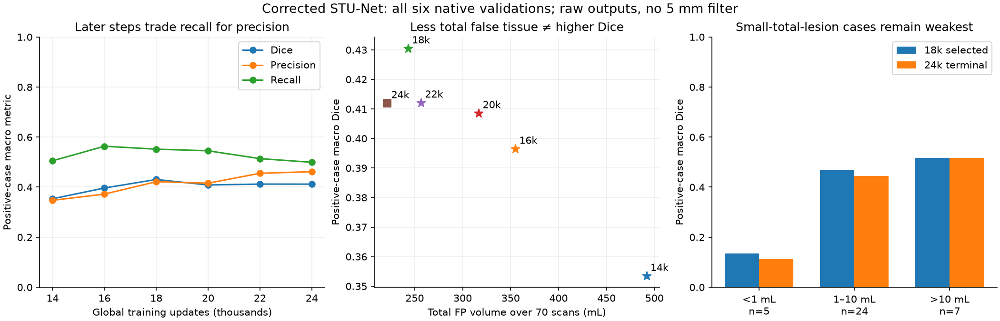
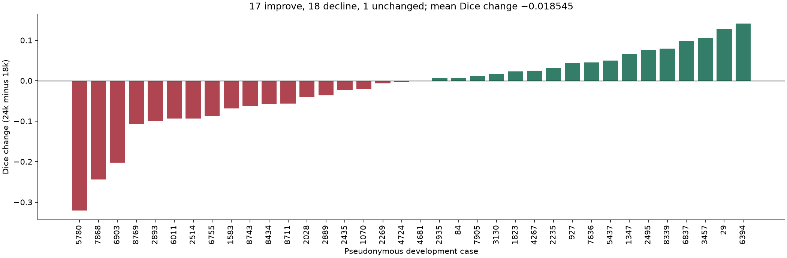
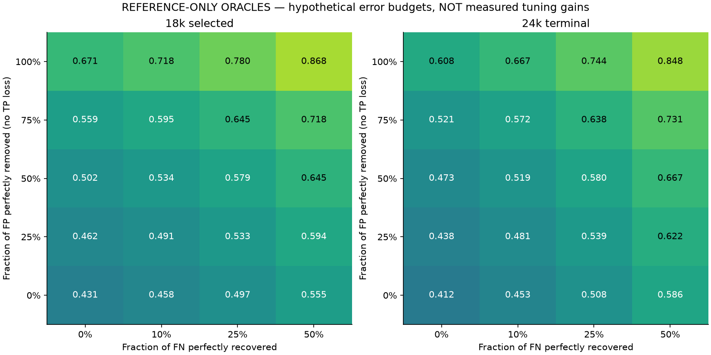

# Terminal STU-Net24k: errors, tuning headroom and next experiment

**Finding:** terminal24k is more conservative than selected18k. It removes some
extra prediction but also loses reference tissue. That makes a removal-only
strategy incomplete. The highest-value tuning question is how to recover useful
lesion tissue without reintroducing excessive false positives.

This is the requested **terminal24k primary analysis**, with selected18k retained
as comparator. All six complete validations and all70cases remain included.
No new inference, array/CT reads, optimizer updates or protected-test access
occurred. The new24k→36k experiment is running separately and was not changed.
These are exposed, supplied-pancreas-region development results with unresolved
pretraining/patient linkage; they are not independent or autonomous test scores.

## Full validation history

Precision and recall below are unweighted means over the same36positive cases.
All36have some predicted lesion, including predictions with zero reference
overlap. Case hits mean any reference overlap; component hits use the frozen
producer's existing matching definition, not clinical detection.

| Global step | Dice | Precision | Recall | Case hits /36 | Component hits /45 | Empty alarms /34 | All-case FP volume(mL) |
| --- | ---: | ---: | ---: | ---: | ---: | ---: | ---: |
| 14k | .353488 | .347291 | .505244 | 32 | 37 | 30 | 491.70 |
| 16k | .396533 | .372145 | .563422 | 35 | 39 | 31 | 354.88 |
| **18k selected** | **.430517** | .421671 | .551734 | 35 | 39 | 29 | 242.99 |
| 20k | .408581 | .415780 | .545229 | 33 | 37 | 27 | 316.80 |
| 22k | .412172 | .455310 | .513887 | 35 | 39 | 26 | 256.58 |
| **24k terminal** | **.411972** | **.461849** | **.499250** | **34** | **38** | **27** | **221.32** |

From18k→24k,17positive cases improved,18declined and1was unchanged. Mean Dice
changed−.018545. Positive-case FP voxels fell150,959→99,719(−33.94%), but missed
reference voxels rose77,864→86,395(+10.96%). Whole-cohort physical FP volume fell
only8.92%; the empty-case physical burden actually rose67.39→73.57mL. Case1389
alone contributes31.08mL,42.24%of the terminal empty-case FP volume. Counting
alarms alone would hide that concentration.

The20k→22k→24k Dice values are approximately flat. This does not prove a permanent
plateau, but the final checkpoint did not continue the improvement seen through
18k. Longer training remains a legitimate test, not an established remedy.

## Where the model works and where it struggles

| Total reference lesion volume | Cases | 18k Dice | 24k Dice | 18k recall | 24k recall |
| --- | ---: | ---: | ---: | ---: | ---: |
| <1mL | 5 | .134660 | .111298 | .436019 | .379244 |
| 1–10mL | 24 | .466785 | .443829 | .582411 | .524395 |
| >10mL | 7 | .517494 | .517515 | .529207 | .498759 |

Large-total-lesion cases already average just over0.50Dice; the largest gap is
the small-total-lesion group. These are case-volume bins, not individual-lesion
size results. Do not remove difficult small cases to improve the headline.
Terminal examples with relatively good overlap include1070(.8062),7636(.7656),
29(.7471),7905(.7241) and927(.7224). Counts do not establish which anatomical or
acquisition features explain their success.

The following terminal cases motivate different tuning directions:

| Case alias | Dice | Recall | Precision | Count-based interpretation |
| --- | ---: | ---: | ---: | --- |
| 4267 | .1677 | .8109 | .0935 | Much of the reference is found, with extensive excess prediction. Candidate for spatial/confidence discrimination. |
| 8339 | .1440 | .5724 | .0824 | Both excess tissue and misses; suppression alone risks the useful overlap. |
| 8769 | .1170 | .0633 | .7706 | Most reference tissue is missed despite relatively precise remaining prediction. More aggressive suppression is poorly motivated here. |
| 7868 | .1117 | .0649 | .4010 | Very little reference tissue retained; Dice declined from.3555 at18k. |
| 6755 | .0000 | .0000 | .0000 | Newly zero-overlap at24k;18k overlapped some reference. A deletion-only filter cannot recover it. |
| 4681 | .0000 | .0000 | .0000 | Zero overlap at both selected and terminal checkpoints. |

5780has the largest Dice decline(.7019→.3813), associated with4,404additional
FP voxels and65additional missed voxels. 6394improves(.3516→.4930) with4,324fewer
FP voxels and unchanged overlap. These are count associations; aligned overlays
and logits are needed before assigning a spatial or biological cause. Prioritize
4267/8339/8769/7868/6755/5780and empty1389for a bounded visual/score follow-up.

## Specificity: two very different answers

Terminal full-native **voxel specificity is99.9919%**, yet27/34reference-empty
scans have a false alarm. The strict reference-empty **case specificity is20.59%**.
At18k it was14.71%. Both can be mathematically correct: enormous background
volumes dominate the voxel denominator, while a single tiny blob triggers the
strict case alarm. Supplied-region inference further limits interpretation.

Optimize positive-case Dice, recall/detection and physical false-positive burden
together. Do not maximize voxel specificity alone. Report any-prediction alarms,
the separately defined50mm³alert, component count and FP volume with explicit
denominators. Reference-empty is not a clinical disease-free adjudication.

## Can tuning get Dice to0.50?

There is numerical headroom, but no measured hyperparameter result yet.

| Reference-only hypothetical correction | 18k | 24k |
| --- | ---: | ---: |
| Actual raw Dice | .430517 | .411972 |
| All FP perfectly removed; existing misses unchanged | .671199 | .607975 |
| All FN perfectly recovered; existing FP unchanged | .653165 | .710443 |
| Uniform fraction of FP that must disappear to reach.50, with **zero TP loss** | 48.98% | 65.27% |

These are **oracles using reference truth**, not confidence thresholds or
deployable results. Fractions are applied within each positive case and Dice
then averaged. The last row is not a guaranteed removable global FP fraction.
For example, perfect removal of50%of each case's FP alone gives terminalDice
.472696; additionally recovering10%of each case's missed tissue gives.518673.
That demonstrates the need for a balanced change, not that a model can achieve
those exact corrections. Empty-case alarm removal alone changes headline Dice
by zero. Do not add oracle gains or project the old5mm gain onto this model.

## Training diagnostics support a targeted test

The first500and last500mean training losses were.610897and.560728(−8.21%).
They use different sampled patches, so this is not a controlled same-input loss
comparison or proof of overfitting. All12k losses were finite. Body and head
gradient norms were nonzero in all24periodic diagnostics: no frozen-head failure
was demonstrated in those samples.

Ten of those periodic diagnostics contained lesion voxels. Three lost the lesion
at the coarsest target: global19501counts1596→212→25→3→0;22501counts
1749→204→20→1→0;23501counts720→90→12→2→0. This repeats the earlier exact-replay
finding in actual scientific diagnostics. The cadence is not random and does
not estimate a cohort-wide rate. The coarsest head has only3.23%of the loss
weight, so its removal may help but is unlikely to explain every error.

All1,333training cases have cumulative exposure, with14–32visits each and24,000
visits total. These counters include the parent phase; they are **not12knew
independent patients** or phase-only visitation counts.

## Recommended experiment order

1. **Qualify raw/fixed5mm at terminal24k, then18k comparator.** This establishes
   the actual checkpoint-specific spatial benefit before a larger sweep.
2. **Test a bounded inference decision study** using lesion-vs-nonlesion margin
   bias plus spatial context, measuring both additions and deletions. The old
   confidence experiment only deleted lesion winners. A common softmax temperature
   alone leaves argmax unchanged. Keep tiny-lesion safeguards and raw outputs.
3. **Test the prepared coarsest-supervision ablation**, with its original matched
   parent/addresses/recipe, separately from the inference filter.
4. **Use a STU-Net-specific Optuna study** for a small LR/loss-balance space if
   expensive training tuning is still justified. The existing Optuna script
   belongs to older SegResNet/DiceFocal/positive-only evaluation and must not be
   run unchanged. Do not tune nonexistent focal gamma in a CE+Dice recipe.

The [detailed protocol](STUNET-TUNING-STRATEGY-20261110.md) defines objective/guard
choices, proposed finite bias/spatial/size grid, training-trial limits, tracking,
confirmation limits and Optuna pruning restrictions. It is prepared analysis,
not a launched hyperparameter search or a promise of0.50Dice.

**Concrete execution constraint:** both peer inventories confirm **no native
masks, probabilities or logits were retained** for18k/24k. Only checkpoints,
reports and journals exist. Therefore a measured spatial/score sweep needs one
new bounded inference reconstruction per checkpoint. The Mac external drive is
not mounted at this review, and Lenovo's GPU owns the36k run. Do not start a
competing job, treat the old12k four-bit cache as24k evidence, or invent a tuned
score from aggregate counts. Next execution needs the Mac drive plus qualified
model import/native parity, AC/resource/storage/backup admission and a frozen
finite request. Interactive AI battery permission does not change experiment gates.
If a MacMPS reconstruction differs from the publisher's retainedCUDA results,
report the new paired Mac raw/policy results separately; preserve the original
scores and the numerical qualification limits.

## Evidence, verification and deliverables

Primary [machine-readable audit](STUNET-24K-TUNING-AUDIT-20261110.json), SHA256
`2bf362f39b73e25a5c5d6a97666a013bc6cfe2ecdbfccdef331c60fdd725db59`,
was generated with the strict CLI and original peer envelope SHA
`4e2bec89a08dae10856f6da618c9c5be149aa19614471a7573d884be08036787`.
An explicit adapter joins the unchanged original inputs.json and inherited
development-provider pins to previously qualified native identities, not merely
equal cohort counts. The wrapper GitLF source reproduces its frozen CRLF digest.

The later extended export at peer4d557f7, SHA
`6413c8cecc8a0e3c64cdb3f0c3ee9731113a33de7cb0442fc8b4d8614407423e`,
independently reproduced **every derived case/series value exactly** with the
direct reader. Its70case/210source hashes, shapes and affines exactly match
the old identities. The first envelope added derived TP/FP/FN fields; those
reproduce arithmetically, and all remaining420case rows equal the untouched
extended publication. [Reconciliation](STUNET-24K-SOURCE-RECONCILIATION-20261110.json)
retains that distinction, diagnostics and inventories. Checkpoint E/C equality,
worker cleanup and MLflow completion are peer saved attestations; Mac did not
reread remote checkpoint bytes or the live database.

Selected18k checkpoint:`3a5615f0c54f3af80202f81fa0234e51e3b38df768a47f00ec4be39c7f624f1a`.
Terminal24k:`2cb9ff72c66b67f8bcdcb081c5d3f84735a83830f693ad2990fb8139933da92c`.
All33completed execution/backup files remain accounted. Raw macro values,
denominators, geometry, stale/reference/receipt/backup refusal and CLI
no-overwrite behavior are covered by the focused tests.
Final focused verification:52tests plus8subtests pass; figures were generated
with the existing Matplotlib runtime and visually checked. No dependency or
scientific environment was changed.

The [new36k launch](../operations/STUNET-LONGER-HANDOFF-20261110.md) verifies
24001–24013advancing, exact full-state import/cold replay and liveMLflow
`dc0b189042704f51af9dbb2deed5f5a6`. First new full validation is26k. No Mac
training, postprocessing deployment or Optuna training trial was launched here.
