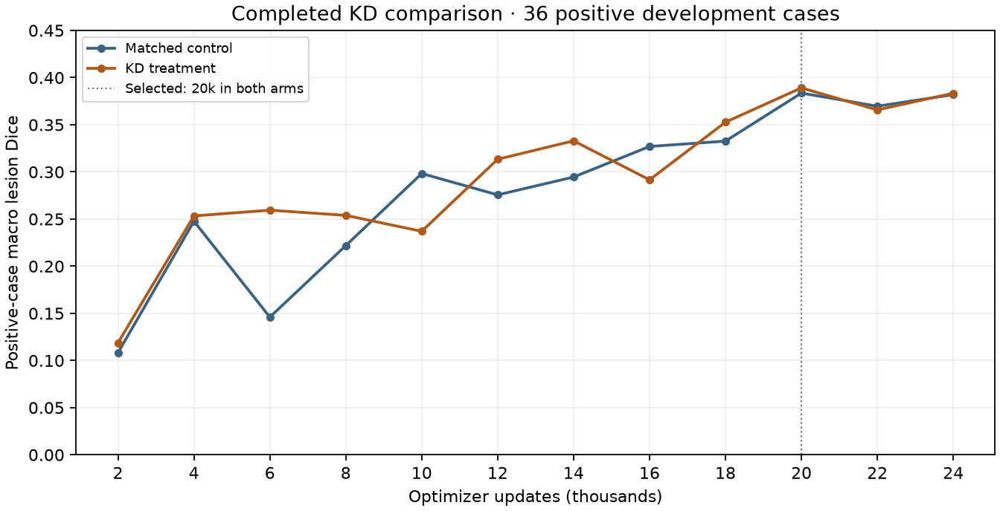

# Completed KD review — November 6

The full matched run is complete. KD produced a small average Dice increase,
but the saved evidence does not establish a useful overall improvement. Keep the
student/control as references and investigate the stronger pretrained candidate
before spending another multi-day budget on the same KD recipe.

This is a descriptive review of the original experiment, not a new training run,
preregistration, independent test, or revised acceptance rule. Its original scope
is teacher-assisted exploratory evaluation with a supplied pancreas region.
Teacher pretraining membership and development patient linkage remain unresolved.

## All validation opportunities

Each point includes the full 70-case development evaluation: lesion Dice averages
all 36 positive cases, including complete misses. The 34 reference-empty cases
are evaluated separately. Both arms selected 20k from the complete twelve-point
series; 24k is reported separately. Early advantages did not persist at the same
size through completion.



| Updates | Control Dice | KD Dice | KD minus control |
| ---: | ---: | ---: | ---: |
| 2,000 | .108186 | .118759 | +.010573 |
| 4,000 | .247713 | .253328 | +.005614 |
| 6,000 | .146009 | .259396 | +.113387 |
| 8,000 | .221860 | .253903 | +.032043 |
| 10,000 | .298290 | .237001 | -.061289 |
| 12,000 | .275628 | .313411 | +.037783 |
| 14,000 | .294552 | .332939 | +.038387 |
| 16,000 | .326973 | .291619 | -.035354 |
| 18,000 | .332652 | .352749 | +.020097 |
| **20,000 selected** | **.383593** | **.389084** | **+.005491** |
| 22,000 | .369640 | .365719 | -.003921 |
| **24,000 terminal** | **.381964** | **.383439** | **+.001475** |

## Errors that qualify the Dice gain

| Measure | Control selected | KD selected | Control terminal | KD terminal |
| --- | ---: | ---: | ---: | ---: |
| Positive macro recall | .525817 | .503801 | .541692 | .519540 |
| Positive macro precision | .394043 | .390978 | .381607 | .374238 |
| Positive cases with any overlap | 34/36 | 33/36 | 34/36 | 34/36 |
| Reference components with any overlap | 39/45 | 37/45 | 39/45 | 37/45 |
| Reference-empty cases with any prediction | 33/34 | 33/34 | 32/34 | 29/34 |
| Total empty-case predicted lesion mL | 54.769936 | 57.576687 | 61.447410 | 60.601428 |
| False-negative voxels, all cases | 88,418 | 92,041 | 85,348 | 88,627 |
| False-positive voxels, all cases | 218,512 | 237,880 | 247,141 | 256,479 |
| Pancreas macro Dice | .778568 | .772516 | .781024 | .779951 |

At each endpoint, 16 positive cases improve, 18 worsen and two are unchanged.
Selected KD additionally completely misses case 2935; both arms miss 4681 and
8769. At terminal, 2935 recovers some overlap, but the component deficit remains.
Any-overlap counts use the existing voxel definition; they are not clinical
sensitivity or proof that most of a lesion was segmented.

The five small-total-lesion-volume cases improve selected Dice from .163733 to
.188711, while their recall falls from .502051 to .417889. Seven large-volume
cases fall from .422306 to .414101 selected Dice. These are patient total-volume
bands, not evidence about individual sub-1 mL components. Nineteen KD cases miss
more than half the annotation versus sixteen control cases at selection.

Selected examples worth inspecting spatially are 6903 (Dice delta -.382774),
5780 (+.362439), 1823 (+.283484), and the new complete miss 2935. Save aligned
control/KD/native CT/reference overlays before attributing causes. Counts alone
cannot locate remote false positives or distinguish boundary spill from an
attached false-positive component. The existing seven-case autonomous gallery
is a different model comparison and does not substitute for these KD overlays.

Patient grouping remains unresolved, including the previously flagged 6755/2889
relationship. No independent-patient confidence interval, H0 decision or formal
practical-acceptance verdict is issued. The small mean gain and worse component
coverage are enough to avoid promoting this KD model on Dice alone.

## Logging and reproducibility

Keep the existing MLflow attempts and their original statuses. The six run IDs
owning the complete validation series are recorded in the adjacent JSON, including
the historically FAILED control continuation and FINISHED treatment. Do not
rewrite that cleanup failure or create another RUNNING training record for this
review. A later comparison-only MLflow record, if desired, should link these
attempts, identify itself as post-hoc analysis, and count zero new training hours.

The [completed execution record](MAC-KD-COMPLETION-20261105.md) retains checkpoint
and independent-backup hashes, final journals, cleanup and tracking verification.
Treatment attempts total 66.841657 supervised hours, including validation and
retained attempts; these are not measured GPU-utilization hours or human hours.

The [analysis JSON](KD-DESCRIPTIVE-ANALYSIS-20261106.json) is generated by
`scripts/diagnostics/review_completed_kd_20261106.py` from the exact completed
report SHA256
`2679c09ebefc2361cb81122ead80530c48fcbeb99b333d2e526d1723a2e0033b`.
The reader verifies all twelve steps, the same 70 unique cases, 36 positives,
reference voxel/component counts, macro Dice, paired differences, voxel-error
sums, and selected/terminal identities. It performs no CT/mask/model reads,
inference, optimizer update or MLflow write and exclusively creates new output.
Original reports, producing sources, checkpoints and receipts are unchanged.

Reproduce into a fresh output file:

```sh
.venv312/bin/python scripts/diagnostics/review_completed_kd_20261106.py \
  --report outputs/prowl/kd-results-20261105-final-01/report.json \
  --output /tmp/prowl-kd-review-UNUSED.json
```

Remaining work is saved-output visual review and reliable patient/source linkage;
another KD training run is not required to make this assessment.
